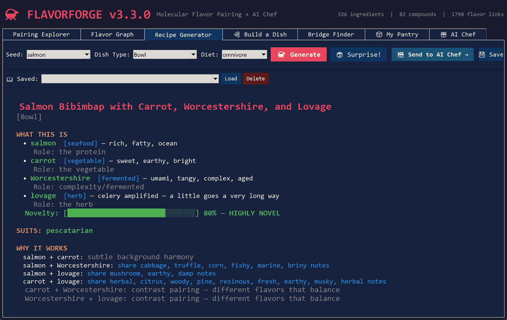

# FlavorForge

[](https://github.com/jamesccupps/FlavorForge/actions/workflows/ci.yml)
[](https://github.com/jamesccupps/FlavorForge/releases/latest)
[](LICENSE)

Procedural cooking engine that builds recipes from molecular flavor pairing, texture contrast and taste balance,
with diet filtering. It runs as a Tkinter desktop app or from the command line, needs nothing beyond a stock
Python, and can hand a recipe to an AI Chef — a local Ollama model or the Claude API — for quantities and steps.

FlavorForge doesn't just mash random ingredients together. It maps 326 real ingredients to 82 aroma compounds
(linalool, furaneol, methylpyrazine and so on) and pairs ingredients that share the rare ones. Then it checks
texture contrast and taste balance so the dish actually works. The AI Chef gets a prompt loaded with the pairing
chemistry, texture gaps, balance problems and a cuisine direction, so what comes back is creative and cookable.

[Latest release](https://github.com/jamesccupps/FlavorForge/releases/latest) ·
[Changelog](CHANGELOG.md) ·
[Install](#install) ·
[Command line](#command-line)



## Features

### Pairing Explorer
Select any ingredient and see its top 25 molecular pairings ranked by shared aroma compound rarity. Discover that strawberry and tomato share 5 compounds, or that coffee and chocolate are connected through 7 different molecules.

### Substitutions
Out of parmesan? The Pairing tab ends with what to use instead. A substitute is a different question from a pairing — a pairing goes *with* an ingredient, a substitute has to stand *in* for it — so suggestions come from the same category, and from the same subtype where there is one. You will never be offered chicken stock in place of a vinaigrette, or orzo in place of a baguette. Suggestions that share real aroma compounds rank above ones that only fill the same role, and the ones that only fill the same role say so.

### Flavor Graph
Interactive network visualization of the entire ingredient database. Nodes are ingredients, edges are shared compounds. Adjust the similarity threshold, filter by category, click nodes to inspect.

### Recipe Generator
Generate random recipe concepts filtered by dish type (Pizza, Pasta, Soup, Curry and more) and diet. Each recipe shows:
- What every ingredient is and why it's there
- Molecular connections between ingredients
- Texture and taste balance analysis with suggestions
- Which diets it suits, and which ingredients to check the label on
- A novelty score

### Build a Dish
Choose a dish type, pick a template, and fill in each slot with guided suggestions. The system recommends ingredients based on:
- **Molecular pairing** — shared aroma compounds
- **Texture gaps** — "missing crunch, try nuts or breadcrumbs"
- **Taste balance** — "no acid, consider lemon or vinegar"

Includes 24 noodle/pasta types, 9 breads, 7 rices, 8 broths, 16 cooking sauces, and 21 dressings.

### Bridge Finder
Pick two ingredients that seem incompatible (chocolate + salmon) and find a third ingredient that shares compounds with both — bridging the gap.

### My Pantry
Check off what's in your fridge and cupboard. "What Can I Make?" finds recipes using only your ingredients. "Almost There" shows recipes where you're one ingredient short — your smart shopping list. The pantry persists between sessions.

### Diet filter
Pick omnivore, pescatarian, vegetarian or vegan on the Recipe tab, or pass `--diet` on the CLI. Two independent filters run: the ingredient pool is narrowed, and templates whose *method* assumes something the diet forbids are dropped entirely.

A diet is a constraint, not a preference. Ask for a vegan recipe built around bacon, or a vegan Sauce & Dip (every dip template assumes dairy or egg), and you get told so — not a recipe that quietly ignores the diet.

That second filter matters. Twenty-eight of the 102 templates name an animal product in prose no slot holds — "finish with cream", "top with a fried egg" — so without it a vegan recipe could instruct you to add parmesan. A chowder without cream is not a chowder, so the honest answer is that it is not vegan and it is not offered.

Classification is per ingredient, because the category cannot carry it: chicken stock is a "sauce", fish sauce and Worcestershire are "fermented", coconut milk is filed under "dairy" because it behaves like cream in a pan, egg noodles contain egg, and mayonnaise is egg rather than milk.

Where the answer genuinely depends on the jar — kimchi, caramel, curry paste, naan, gnocchi, chocolate — the app says *check the label* rather than picking an answer or quietly dropping half your condiments.

### Compound lookup
The database is a mapping and could only ever be read one way: pick an ingredient, see its compounds. *What else tastes of geosmin?* is the more interesting half, and `--compound` answers it — exactly, or by searching compound names and descriptions.

### AI Chef
Send any generated recipe to Ollama or the Claude API. The prompt includes:
- Ingredient profiles with texture tags and taste percentages
- Molecular pairing explanations
- Contrast pairing suggestions
- Texture and taste balance warnings with fix suggestions
- Cuisine direction and dietary flags
- A structured output format

AI-generated recipes save as text files to `~/FlavorForge_Recipes/`. Setup is [below](#ai-chef-setup).

## Install

### Requirements
- **Python 3.10+**
- **tkinter**, for the GUI only (included with Python on most systems)
- No pip packages — the program is one file on the standard library

### Quick start
```bash
git clone https://github.com/jamesccupps/FlavorForge.git
cd FlavorForge
python flavorforge.py            # the GUI
python flavorforge.py --help     # or the command line
```

`pip install .` from the clone adds a `flavorforge` command, which is what the
CLI examples below use; without it, `python flavorforge.py` does the same.

tkinter is only needed for the GUI. The database, the engine and the CLI run
without it, so a headless server can still answer `--pair` and `--recipe`.

### Windows
Download and double-click `flavorforge.py`, or:
```powershell
python flavorforge.py
```

### Linux
tkinter may need to be installed separately:
```bash
# Ubuntu/Debian
sudo apt install python3-tk

# Fedora
sudo dnf install python3-tkinter

python3 flavorforge.py
```

### macOS
```bash
python3 flavorforge.py
```

## Command line

The engine doesn't need the GUI. Useful for scripting, for a headless box, or just for a quick answer:

```bash
flavorforge --pair garlic                        # top molecular pairings
flavorforge --substitute parmesan                # what to use instead
flavorforge --bridge chocolate salmon            # what connects two ingredients
flavorforge --compound geosmin                   # everything carrying a compound
flavorforge --compound mushroom                  # ...or search for the compound
flavorforge --recipe --seed salmon --dish-type Soup
flavorforge --recipe --diet vegan
flavorforge --list --category mushroom
```

Run it with no arguments and you get the GUI.

```
$ flavorforge --substitute parmesan -n 4
parmesan  [dairy]  sharp, savory, crystalline
compounds: acetic acid, acetoin, butyric acid, diacetyl, ethyl butyrate, hexanal, methylpyrazine

  ingredient              score  shared aroma
  pecorino                0.755  butyric acid, acetic acid, acetoin, diacetyl
  feta                    0.560  butyric acid, acetic acid, acetoin, diacetyl
  cheddar                 0.487  butyric acid, acetoin, diacetyl, methylpyrazine
  gruyere                 0.479  butyric acid, acetoin, diacetyl, methylpyrazine
```

## AI Chef setup

FlavorForge works standalone — the AI Chef tab is optional.

### Ollama (local, free)
1. Install [Ollama](https://ollama.com)
2. Pull a model: `ollama pull qwen2.5:14b` (or llama3, mistral, etc.)
3. In FlavorForge → AI Chef tab → set URL to `http://localhost:11434` and model name
4. Hit "Test" → "Save"

### Claude API (Anthropic)
1. Get a key from the [Claude Console](https://platform.claude.com)
2. AI Chef tab → Provider: `anthropic` → paste the key → **Save**
3. Pick a model from the dropdown:

| Model | When |
|---|---|
| `claude-opus-5-5` | most capable — best recipes, highest cost (default) |
| `claude-sonnet-5-5` | strong and cheaper — a good everyday default |
| `claude-haiku-5-5` | fastest and cheapest |

A model saved by an earlier version moves to its successor in the same tier —
Opus to Opus, Haiku to Haiku — and the AI tab says so beside the dropdown.

**Test** checks the key and the model against the API without spending any
tokens, so a typo'd key shows up there rather than at Generate.

Responses stream, so the recipe types itself out rather than appearing all at
once after a wait. If one is ever cut short by the token limit, it says so
instead of just stopping mid-step.

The key is stored in `~/.flavorforge_config.json`, written owner-only on
Linux and macOS. It is sent to `api.anthropic.com` and nowhere else. The
integration uses `urllib` rather than the official SDK so that FlavorForge
stays one file you can run against a stock Python.

## How it works

### Molecular flavor pairing
Each ingredient is mapped to its key volatile aroma compounds. When two ingredients share compounds — especially rare ones — they harmonize on a molecular level.

FlavorForge scores this with a **rarity-weighted Jaccard similarity**: the ordinary Jaccard index (shared ÷ combined) with each compound weighted by inverse document frequency, `log(N / ingredients_containing_it)`, instead of counted as 1. Identical profiles score 1.0, disjoint ones 0.0.

Rarity is doing real work here. Hexanal — grassy, green — is in 62% of the database, so it carries about **8%** of the weight of a compound found in a single ingredient. Sharing hexanal tells you almost nothing, and the score says so.

> **This changed in 3.1, and it changed every number the app shows.** Through 3.0 the weight was `0.5 + 0.5 × rarity`, whose constant floor swamped the rarity term: hexanal scored 0.68 against a ceiling of 1.0, or 70% of a unique compound. The measurable effect was that of the 31,387 ingredient pairs the app reported as connected, 16,501 — **52.6%** — shared nothing but hexanal, linalool or nonanal. Over half of every "pairing" was three compounds that are in almost everything. The 3.0 formula was also not Jaccard, despite this section having said so since 1.0: it divided by the average profile size rather than by the union.

Ranked lists go one step further and drop matches resting *entirely* on compounds present in more than 30% of the database. Scoring already pushes those down; excluding them keeps a short honest list in place of 25 rows of coincidence. The two populations genuinely cannot be separated by a score threshold — 85% of pairs with a real shared compound score below the *highest* ubiquitous-only pair — so the filter works on the shared set, not on a cutoff.

### Texture contrast
Every ingredient has texture tags (crispy, creamy, chewy, tender, etc.). The balance system checks for missing texture dimensions and suggests fixes: "Missing crunch — try adding nuts, seeds, or crispy onions."

### Taste balance
Ingredients carry taste profiles across seven core dimensions — salty, sweet, sour, bitter, umami, fatty, spicy — plus starchy, earthy and smoky where they apply. The system identifies gaps: "Heavy on salt but missing acid — add citrus, vinegar, or pickled element."

### Smart slot types
Templates draw their ingredients from **23 slot types**. The specialized ones filter to the right ingredients:
- `noodle` → 24 pasta/noodle options (spaghetti, udon, rice noodles, gnocchi...)
- `bread` → 9 bread options (sourdough, ciabatta, naan, pita...)
- `rice_type` → 7 rice options (jasmine, basmati, arborio, sticky...)
- `broth` → 8 stock/broth options (dashi, bone broth, coconut broth...)
- `cooking_sauce` → 16 sauces (marinara, pesto, alfredo, curry paste...)
- `dressing` → 21 condiment dressings (gochujang, harissa, miso...)

## The database

326 ingredients across 17 categories, 82 aroma compounds, 1,790 ingredient-compound links, and 102 recipe templates across 16 dish types.

| Category | Count | Examples |
|---|---|---|
| Grains & Starches | 48 | 24 noodles/pastas, 9 breads, 7 rices, plus quinoa / polenta / farro / couscous |
| Vegetables | 42 | tomato, beet, fennel, bok choy, artichoke, arugula |
| Spices | 35 | garam masala, za'atar, Old Bay, five spice |
| Dairy & Cheese | 31 | gruyere, cotija, labneh, halloumi, paneer; plant milks and cashew cream |
| Fermented | 27 | miso, gochujang, kimchi, balsamic, red wine, black tea |
| Sauces | 24 | marinara, alfredo, curry paste, chimichurri |
| Fruits | 19 | strawberry, fig, passion fruit, lychee |
| Herbs | 19 | basil, tarragon, lemongrass, shiso, Thai basil, lovage |
| Proteins | 15 | chicken, beef, duck, tofu, tempeh, seitan, jackfruit |
| Nuts & Seeds | 14 | tahini, macadamia, peanut butter, sesame seeds |
| Seafood | 10 | salmon, shrimp, scallop, lobster, anchovy, squid |
| Legumes | 8 | lentils, chickpeas, black beans, edamame, fava beans |
| Sweeteners | 8 | honey, maple syrup, molasses, date syrup, agave |
| Citrus | 7 | lemon, lime, orange, yuzu, blood orange, mandarin |
| Mushrooms | 7 | chanterelle, morel, shiitake, truffle |
| Oils & Fats | 7 | olive oil, butter, sesame oil, ghee, duck fat |
| Alliums | 5 | garlic, onion, shallot, leek, scallion |

The templates cover One-Pot, Pasta & Noodles, Stir-Fry & Wok, Curry & Stew, Tacos & Wraps, Bowl, Soup (13 templates including chowders, ramen, pho, tom yum, gazpacho), Casserole & Bake (including mac & cheese), Grilled & Seared (including fried chicken), Salad & Slaw (including ceviche), Breakfast & Brunch, Sandwich (including burgers), Pizza & Flatbread, Dessert & Sweet, Snack & Appetizer (including wings, nachos, dumplings, empanadas, loaded fries), and Sauce & Dip.

## Where it keeps things

FlavorForge saves user data to your home directory:

| File | Purpose |
|---|---|
| `~/.flavorforge_config.json` | AI Chef settings (provider, URL, model, API key) |
| `~/.flavorforge_pantry.json` | Your pantry ingredient list |
| `~/.flavorforge_saved_recipes.json` | Saved recipe concepts |
| `~/FlavorForge_Recipes/` | AI-generated full recipe text files |

## Development

```bash
pip install -e .[dev]
python -m pytest
```

The tests cover the data, the scoring, the generator, the diet rules, the CLI, the AI Chef against a local stub
server, persistence, and the GUI driven without a mainloop. Counts and figures quoted in this README are asserted
against the data, so a stale number fails the build. CI runs on Linux and Windows across Python 3.10–3.14, with the
GUI tests under Xvfb on Linux. Changes are recorded in [CHANGELOG.md](CHANGELOG.md).

## Credits

Flavor compound data is based on research from:
- **FlavorDB** — Indian Institute of Technology
- **Ahn et al. (2011)** — "Flavor network and the principles of food pairing" (Scientific Reports)
- **Foodpairing.com** methodology

Built by [James Cupps](https://github.com/jamesccupps).

## License

MIT License — see [LICENSE](LICENSE).
